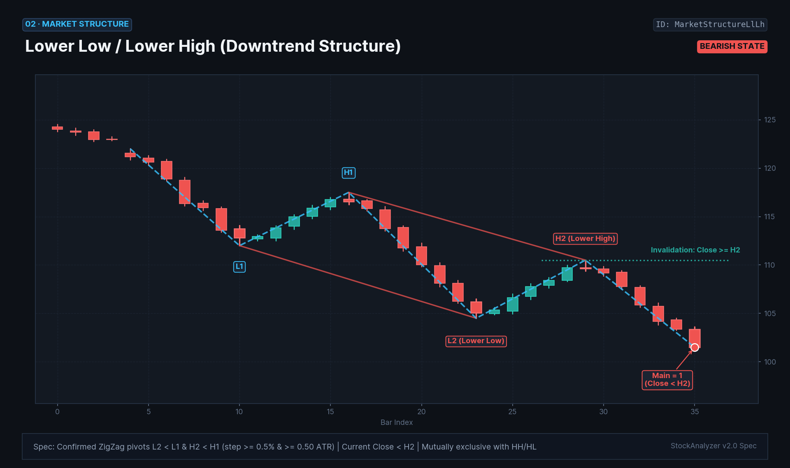

# Lower Low / Lower High (Bearish Market Structure) — Strict Specification (v2.0)

- **Category**: `Market Structure`
- **Indicator Identifier (`IndicatorType`)**: `MarketStructureLlLh`
- **Output Domain**: Unidirectional (`Main ∈ {null, 0m, 1m}`)
- **Minimum Required History $N_{\min}$**: 20 bars (ATR14 + at least 2 confirmed swing highs and 2 confirmed swing lows)
- **Theoretical Basis**: Dow Theory (fundamental downtrend definition: LL + LH)
- **Common Mathematical Definitions**: [00_COMMON_MATHEMATICAL_DEFINITIONS.md](../00_COMMON_MATHEMATICAL_DEFINITIONS.md)
- **Symmetric Mirror Indicator (Bullish)**: [03_higher_high_higher_low.md](03_higher_high_higher_low.md) (`MarketStructureHhHl`, sharing `HigherHighHigherLowEngine` via `CoreStructureTrendIndicatorBase`)

## Visual Reference

> [!NOTE]
> This chart image is a conceptual visual illustration for reference only. Actual detection results depend on the strict mathematical rules, parameters, and market data, and may not match this illustration.

## 1. Pattern Overview
A state indicator identifying a healthy bearish market structure where both the latest two confirmed swing lows and latest two confirmed swing highs step strictly lower, and the current closing price remains below the most recent confirmed swing high (`HigherHighHigherLowEngine`, `side = -1`).

## 2. Price Zone and Prior Trend Definition
- **Current-Price Structural Maintenance Constraint**: When `RequireCloseAboveLastLow == true` (shared UI/parameter default), requires current close $C_t < H_2$ (eliminates false positives after the latest confirmed swing high is broken; mirror side requires $C_t > L_2$).
- **Swing Detection Criteria**: Confirmed causal ZigZag pivots (`CausalZigZag.Extract`, `FractalBars = 0`, default `ZigZagThresholdPercent = 3.0` `[0.5, 30.0]`, minimum amplitude $\ge \text{MinSwingAtrMultiplier} \cdot \text{ATR}_{\text{ctx}}$, default `1.5` `[0.0, 5.0]`).

## 3. Period (Time Axis & Bar Count) Definition
- **Structural Swing Effective Span**: Distance between oldest ($q_0$) and newest ($q_3$) of the 4 latest alternating confirmed pivots $(H_1, L_1, H_2, L_2)$ must lie in $[\text{MinSpan}, \text{MaxSpan}]$ bars, where $\text{MaxSpan} = 2 \cdot \text{MaxPivotIntervalBars}$, $\text{geomMaxSpan} = \max(0, \text{MaxSpan} - 1)$, and $\text{MinSpan} = \min\!\big(10,\; \min(2 \cdot \text{MinPivotIntervalBars} + 2,\; \text{geomMaxSpan})\big)$ (with defaults `Min=4 [2, 20]`, `Max=60 [15, 200]`, span is $[10, 120]$ bars).
- **Consecutive High Spacing ($i_{H2} - i_{H1}$) and Low Spacing ($i_{L2} - i_{L1}$)**: Each in $[\text{MinPivotIntervalBars}, \text{MaxPivotIntervalBars}]$ (default $[4, 60]$ bars).
- **Recency Limit**: $t - \max(i_{H2,\text{conf}}, i_{L2,\text{conf}}) \le \text{MaxLastPivotAgeBars}$ (default `40` `[5, 200]` bars).
- **Required Warmup Bars**: $\max\!\big(500,\; 2 \cdot \text{MaxPivotIntervalBars} + \text{MaxLastPivotAgeBars} + 20\big)$ (`StructureTrendWarmupMarginBars = 20`).

## 4. Geometric Ratios and Price Tolerances
- **Lower Low (LL)**: $L_1 > 0 \;\land\; \Delta_L > 0 \;\land\; \dfrac{\Delta_L}{L_1} \ge \dfrac{\text{MinStepUpPercent}}{100} \;\land\; i_{L2} \ge 15 \;\land\; \Delta_L \ge 0.50 \cdot \text{ATR}_{\text{ctx}}(i_{L2}-1, 14)$ ($\Delta_L = L_1 - L_2$, default `MinStepUpPercent = 0.5` `[0.0, 10.0]`).
- **Lower High (LH)**: $H_1 > 0 \;\land\; \Delta_H > 0 \;\land\; \dfrac{\Delta_H}{H_1} \ge \dfrac{\text{MinStepUpPercent}}{100} \;\land\; i_{H2} \ge 15 \;\land\; \Delta_H \ge 0.50 \cdot \text{ATR}_{\text{ctx}}(i_{H2}-1, 14)$ ($\Delta_H = H_1 - H_2$).
  - When `MinStepUpPercent = 0m`, only the ATR condition ($\ge 0.50 \cdot \text{ATR}_{\text{ctx}}$) and $\Delta > 0$ apply. If $i_{\text{later}} < 15$ (ATR unavailable, R-16) or origin price $\le 0$, evaluates to `0m`.
- **Alternation and Price Ordering**: Trailing two pairs of alternating confirmed pivots with $H_1, H_2, L_1, L_2 > 0 \;\land\; H_2 > L_2$.
- **Mutual Exclusivity**: Strict sign separation between `H2 > H1` vs. `H1 > H2` (and `L2 > L1` vs. `L1 > L2`) guarantees `MarketStructureLlLh` and `MarketStructureHhHl` can never simultaneously output `1m` on the same bar under identical parameters.

## 5. Signal Confirmation Triggers (`Forming` vs. `Confirmed` & `Invalidated`)
- **`Forming`**: $L_2 < L_1$ holds, while lower high $H_2$ is not yet confirmed (`Main = 0m`).
- **`Confirmed`**: State indicator outputting `Main = 1m` on every bar satisfying LL & LH conditions and $C_t < H_2$ (when `RequireCloseAboveLastLow` is enabled).
- **`Invalidated`**: Transitions to `0m` immediately when $C_t \ge H_2$ or a newly confirmed swing low satisfies $L_{\text{new}} \ge L_2$.

## 6. Implementation Alignment, Compatibility, and Anomaly/Boundary Contract
- **Implementation Structure**: Implemented via `CoreMarketStructureLlLhIndicator` (`CoreStructureTrendIndicatorBase`, `TrendSide => -1`) and `HigherHighHigherLowEngine.Run(ctx, p, side: -1)`.
- **Legacy `Criteria` Non-Mapping**: Added in v2 as the bearish mirror indicator; no legacy Criteria entry exists in the 56-item `LegacyCriteriaNameMap`.
- **Common Anomaly Contract**: Return `null` when history is insufficient ($t + 1 < 20$); return `0m` without throwing exceptions on OHLCV integrity violations, non-positive denominators ($\le 0$), or non-positive prices ($P \le 0$). All price comparisons use `decimal`.
