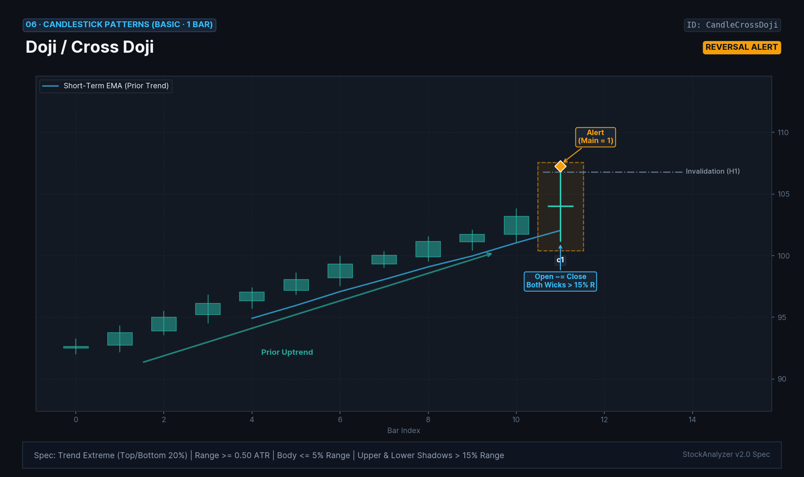

# Doji / Cross Doji — Strict Specification (v2.0)

- **Category**: `Candlestick Patterns` (Subcategory: Basic)
- **Indicator Identifier (`IndicatorType`)**: `CandleCrossDoji`
- **Bar Count**: `1` bar (pattern interval $[s, t] = [t - 0, t]$, context end $e = t - 1$, minimum required history $N_{\min} = 21 bars$)
- **Output Domain**: Unidirectional (Neutral Reversal Alert: `1m`) (`Main ∈ {null, 0m, 1m}`)
- **Theoretical Basis**: Sakata Five Methods / Steve Nison, *Japanese Candlestick Charting Techniques* / Thomas Bulkowski, *Encyclopedia of Candlestick Charts*
- **Common Mathematical Definitions**: [00_COMMON_MATHEMATICAL_DEFINITIONS.md](../00_COMMON_MATHEMATICAL_DEFINITIONS.md)

## Visual Reference

> [!NOTE]
> This chart image is a conceptual visual illustration for reference only. Actual detection results depend on the strict mathematical rules, parameters, and market data, and may not match this illustration.

## 1. Price Zone and Prior Trend Definition (Role: Uptrend or Downtrend Extreme Zone (Reversal Alert))
- **Prior Trend (Required)**: To filter out meaningless mid-range Dojis, a clear trend must exist at bar $e = t - k$: $|C_e - C_{e-10}| \ge 1.5 \cdot \text{ATR}_{\text{ctx}}(e, 14)$.
- **Price Zone (Extreme Zone)**: Must occur in either the top zone ($\text{Pos}(H_t, t, 20) \ge 1 - \text{PriceZoneThreshold}$) or bottom zone ($\text{Pos}(L_t, t, 20) \le \text{PriceZoneThreshold}$); linked to `CoreCandlePatternParameter.CreateFor(IndicatorType.CandleCrossDoji)` default `PriceZoneThreshold = 0.20m` (top $\ge 0.80$ / bottom $\le 0.20$).

## 2. Period (Time Axis & Bar Count) Definition
- **Pattern Formation Bars**: Strictly **1 consecutive bar** (interval $[t - 0,\; t]$). Missing bars within the pattern are not permitted.
- **Context Reference Window**: $\text{AvgBody}_{\text{ctx}}$ and $\text{ATR}_{\text{ctx}}$ are computed over the 14 consecutive bars ending at $e = t - 1$ ($[e - 13,\; e]$) (context separation).
- **Prior Trend, Price Zone, and Volume Windows**: Prior trend $L_{\text{st}} = 10$ bars; price zone range $N_{\text{zone}} = 20$ bars; average volume $L_{\text{vol}} = 20$ bars.
- **Signal Active Duration**: `1m` on completion bar $t$ only (single-bar event; retroactive repainting of past bars is prohibited).

## 3. Geometric Ratios and Price Tolerances
1-bar structure $(c_t)$:
- Standard Doji predicate: $\text{IsDoji}_{\text{normal}}(c_t)$ ($R_t \ge 0.50 \cdot \text{ATR}_{\text{ctx}} \land B_t \le 0.05 \cdot R_t$).
- Both upper and lower shadows present: $U_t > 0.15 \cdot R_t \;\land\; D_t > 0.15 \cdot R_t$.

## 4. Signal Confirmation Triggers (`Forming` vs. `Confirmed` & `Invalidated`)
- **Confirmation Bar ($t$)**: Confirmed upon bar $t$ close at a trend extreme (top or bottom zone).
- **Post-Signal Invalidation Level (`InvalidationLevel`; does not retroactively alter past `Main` at bar $t$)**:
  - Post-signal invalidation: next-bar close breaks outside $[L_t, H_t]$ in the direction of the prior trend.

## 5. Current Implementation Gaps and Anomaly/Boundary Contract
- **Parameter Linkage**: `CandlestickPredicates.T5Holds` actively references `PriceZoneThreshold` (default `0.20m`) from `CoreCandlePatternParameter.CreateFor(IndicatorType.CandleCrossDoji)`.
- **No Exclusive Shadowing**: Evaluated independently using only this pattern's predicates (equivalent to `stopOnFirst: false`).
- **Common Anomaly Contract**: Return `null` when history is insufficient ($t + 1 < 21$); return `0m` without throwing exceptions on OHLC integrity violations, $R_i \le 0$, or $\text{AvgBody}_{\text{ctx}} \le 0 \land \text{ATR}_{\text{ctx}} \le 0$.
