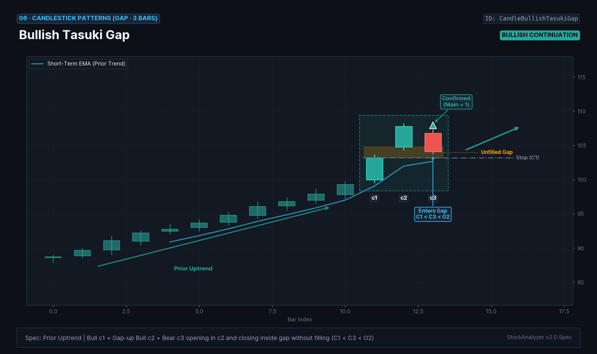

# Bullish Tasuki Gap — Strict Specification (v2.0)

- **Category**: `Candlestick Patterns` (Subcategory: Gap)
- **Indicator Identifier (`IndicatorType`)**: `CandleBullishTasukiGap`
- **Bar Count**: `3` bars (pattern interval $[s, t] = [t - 2, t]$, context end $e = t - 3$, minimum required history $N_{\min} = 23 bars$)
- **Output Domain**: Unidirectional (Bullish Continuation: `1m`) (`Main ∈ {null, 0m, 1m}`)
- **Theoretical Basis**: Sakata Five Methods / Steve Nison, *Japanese Candlestick Charting Techniques* / Thomas Bulkowski, *Encyclopedia of Candlestick Charts*
- **Common Mathematical Definitions**: [00_COMMON_MATHEMATICAL_DEFINITIONS.md](../00_COMMON_MATHEMATICAL_DEFINITIONS.md)

## Visual Reference

> [!NOTE]
> This chart image is a conceptual visual illustration for reference only. Actual detection results depend on the strict mathematical rules, parameters, and market data, and may not match this illustration.

## 1. Price Zone and Prior Trend Definition (Role: Within Uptrend (Bullish Continuation))
- **Prior Uptrend (Required)**: At bar $e = t - k$, $C_e - C_{e-10} \ge 1.0 \cdot \text{ATR}_{\text{ctx}}(e, 14) \;\land\; C_e \ge \text{EMA}_{20}(e) \;\land\; \left(C_e > \text{EMA}_{10}(e) \lor \text{EMA}_{10}(e) > \text{EMA}_{20}(e)\right)$.
- **Price Zone (High Zone to Mid-Pullback)**: Pattern first-bar close $C_s$ lies within the top 40% of the trailing $N_{\text{zone}} = 20$-bar range ($\text{Pos}(C_s, s, 20) \ge 1 - \text{PriceZoneThreshold}$, evaluating to $\ge 0.60$ under `CoreCandlePatternParameter.CreateFor` default `PriceZoneThreshold = 0.40m`, `CandlestickPredicates.T3Holds`).

## 2. Period (Time Axis & Bar Count) Definition
- **Pattern Formation Bars**: Strictly **3 consecutive bars** (interval $[t - 2,\; t]$). Missing bars within the pattern are not permitted.
- **Context Reference Window**: $\text{AvgBody}_{\text{ctx}}$ and $\text{ATR}_{\text{ctx}}$ are computed over the 14 consecutive bars ending at $e = t - 3$ ($[e - 13,\; e]$) (context separation).
- **Prior Trend, Price Zone, and Volume Windows**: Prior trend $L_{\text{st}} = 10$ bars; price zone range $N_{\text{zone}} = 20$ bars; average volume $L_{\text{vol}} = 20$ bars.
- **Signal Active Duration**: `1m` on completion bar $t$ only (single-bar event; retroactive repainting of past bars is prohibited).

## 3. Geometric Ratios and Price Tolerances
3-bar structure $(c_1, c_2, c_3)$:
- $c_1, c_2$: Consecutive bullish candles, $B_1 \ge 0.80 \cdot \text{AvgBody}_{\text{ctx}}$, upward real-body gap $O_2 > C_1 + 0.10 \cdot \text{AvgBody}_{\text{ctx}}$ (strict wick gap: $L_2 > H_1$).
- $c_3$: Bearish candle with $O_2 \le O_3 \le C_2 + 0.20 \cdot \text{AvgBody}_{\text{ctx}}$ entering the gap without closing it: $C_1 < C_3 < O_2$.

## 4. Signal Confirmation Triggers (`Forming` vs. `Confirmed` & `Invalidated`)
- **Confirmation Bar ($t$)**: Confirmed when $c_3$ closes inside the gap without filling it.
- **Post-Signal Invalidation Level (`InvalidationLevel`; does not retroactively alter past `Main` at bar $t$)**:
  - Post-signal stop level $P_{\text{stop}} = C_1$.

## 5. Current Implementation Gaps and Anomaly/Boundary Contract
- Current implementation omits prior uptrend verification.
- **No Exclusive Shadowing**: Evaluated independently using only this pattern's predicates (equivalent to `stopOnFirst: false`).
- **Common Anomaly Contract**: Return `null` when history is insufficient ($t + 1 < 23$); return `0m` without throwing exceptions on OHLC integrity violations, $R_i \le 0$, or $\text{AvgBody}_{\text{ctx}} \le 0 \land \text{ATR}_{\text{ctx}} \le 0$.
