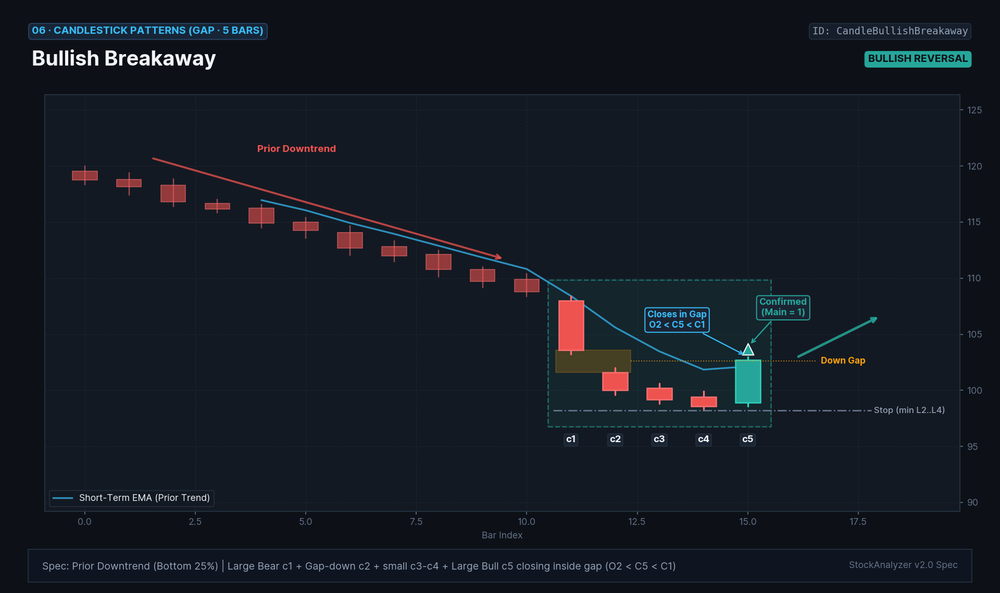

# Bullish Breakaway — Strict Specification (v2.0)

- **Category**: `Candlestick Patterns` (Subcategory: Gap)
- **Indicator Identifier (planned `IndicatorType`)**: `CandleBullishBreakaway`
- **Bar Count**: `5` bars (pattern interval $[s, t] = [t - 4, t]$, context end $e = t - 5$, minimum required history $N_{\min} = 25 bars$)
- **Output Domain**: Unidirectional (Bullish: `1m`) (`Main ∈ {null, 0m, 1m}`)
- **Theoretical Basis**: Sakata Five Methods / Steve Nison, *Japanese Candlestick Charting Techniques* / Thomas Bulkowski, *Encyclopedia of Candlestick Charts*
- **Common Mathematical Definitions**: [00_COMMON_MATHEMATICAL_DEFINITIONS.md](../00_COMMON_MATHEMATICAL_DEFINITIONS.md)

## Visual Reference

> [!NOTE]
> This chart image is a conceptual visual illustration for reference only. Actual detection results depend on the strict mathematical rules, parameters, and market data, and may not match this illustration.

## 1. Price Zone and Prior Trend Definition (Role: Downtrend Bottom Zone (Bullish Reversal))
- **Prior Downtrend (Required)**: At the immediately preceding bar $e = t - k$, 10-bar price change ($L_{\text{st}} = 10$) satisfies $C_{e-10} - C_e \ge 1.5 \cdot \text{ATR}_{\text{ctx}}(e, 14) \;\land\; C_e < \text{EMA}_{10}(e) \;\land\; \text{EMA}_{10}(e) < \text{EMA}_{10}(e-3)$.
- **Price Zone (Bottom Zone)**: Pattern lowest low $L_{\text{pat}} = \min_{i \in [s, t]} L_i$ lies within the bottom 25% of the trailing $N_{\text{zone}} = 20$-bar range ($\text{Pos}(L_{\text{pat}}, t, 20) \le 0.25$).

## 2. Period (Time Axis & Bar Count) Definition
- **Pattern Formation Bars**: Strictly **5 consecutive bars** (interval $[t - 4,\; t]$). Missing bars within the pattern are not permitted.
- **Context Reference Window**: $\text{AvgBody}_{\text{ctx}}$ and $\text{ATR}_{\text{ctx}}$ are computed over the 14 consecutive bars ending at $e = t - 5$ ($[e - 13,\; e]$) (context separation).
- **Prior Trend, Price Zone, and Volume Windows**: Prior trend $L_{\text{st}} = 10$ bars; price zone range $N_{\text{zone}} = 20$ bars; average volume $L_{\text{vol}} = 20$ bars.
- **Signal Active Duration**: `1m` on completion bar $t$ only (single-bar event; retroactive repainting of past bars is prohibited).

## 3. Geometric Ratios and Price Tolerances
5-bar structure $(c_1 \dots c_5)$:
- $c_1$: Large bearish candle ($C_1 < O_1 \;\land\; \text{IsLarge}(c_1)$).
- $c_2$: Gap-down bearish candle $O_2 < C_1 - 0.10 \cdot \text{AvgBody}_{\text{ctx}}$.
- $c_3, c_4$: $\text{IsSmall}$, no early gap intrusion ($\max(C_3, C_4) < O_2$), excluding sustained bounce ($\neg(L_4 > L_3 \land C_4 > C_2)$).
- $c_5$: Large bullish breakout ($B_5 \ge 1.20 \cdot \text{AvgBody}_{\text{ctx}} \lor \text{IsLarge}(c_5)$), closing above intermediate bodies ($C_5 > \max_{i \in \{2,3,4\}} \max(O_i, C_i)$; strict wick gap: $C_5 > \max(H_2, H_3, H_4)$) and inside the gap ($O_2 < C_5 < C_1$).

## 4. Signal Confirmation Triggers (`Forming` vs. `Confirmed` & `Invalidated`)
- **Confirmation Bar ($t$)**: `Main = 1m` upon close of $c_5$.
- **Post-Signal Invalidation Level (`InvalidationLevel`; does not retroactively alter past `Main` at bar $t$)**:
  - Post-signal stop level $P_{\text{stop}} = \min(L_2, L_3, L_4)$.

## 5. Current Implementation Gaps and Anomaly/Boundary Contract
- Current implementation omits prior downtrend and bottom-zone checks.
- **No Exclusive Shadowing**: Evaluated independently using only this pattern's predicates (equivalent to `stopOnFirst: false`).
- **Common Anomaly Contract**: Return `null` when history is insufficient ($t + 1 < 25$); return `0m` without throwing exceptions on OHLC integrity violations, $R_i \le 0$, or $\text{AvgBody}_{\text{ctx}} \le 0 \land \text{ATR}_{\text{ctx}} \le 0$.
