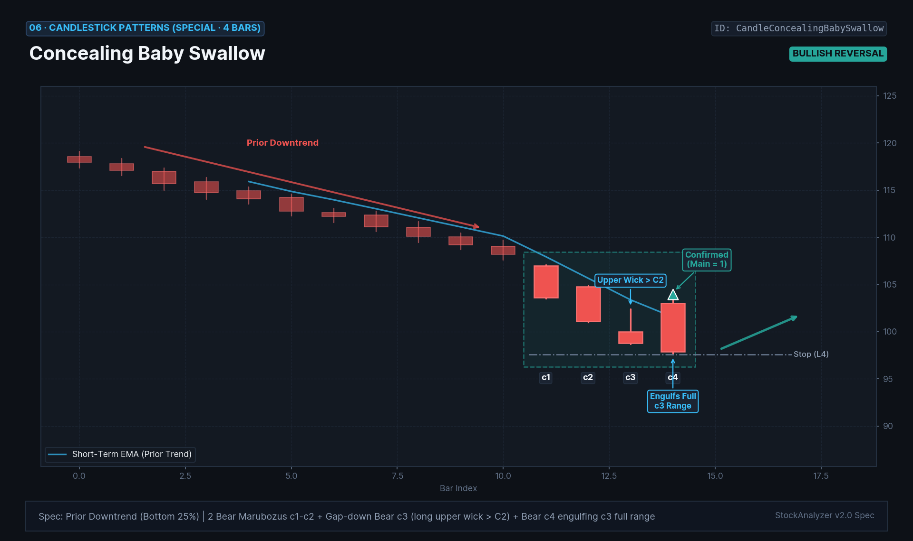

# Concealing Baby Swallow — Strict Specification (v2.0)

- **Category**: `Candlestick Patterns` (Subcategory: Special)
- **Indicator Identifier (planned `IndicatorType`)**: `CandleConcealingBabySwallow`
- **Bar Count**: `4` bars (pattern interval $[s, t] = [t - 3, t]$, context end $e = t - 4$, minimum required history $N_{\min} = 24 bars$)
- **Output Domain**: Unidirectional (Bullish: `1m`) (`Main ∈ {null, 0m, 1m}`)
- **Theoretical Basis**: Sakata Five Methods / Steve Nison, *Japanese Candlestick Charting Techniques* / Thomas Bulkowski, *Encyclopedia of Candlestick Charts*
- **Common Mathematical Definitions**: [00_COMMON_MATHEMATICAL_DEFINITIONS.md](../00_COMMON_MATHEMATICAL_DEFINITIONS.md)

## Visual Reference

> [!NOTE]
> This chart image is a conceptual visual illustration for reference only. Actual detection results depend on the strict mathematical rules, parameters, and market data, and may not match this illustration.

## 1. Price Zone and Prior Trend Definition (Role: Downtrend Bottom Zone (Bullish Reversal))
- **Prior Downtrend (Required)**: At the immediately preceding bar $e = t - k$, 10-bar price change ($L_{\text{st}} = 10$) satisfies $C_{e-10} - C_e \ge 1.5 \cdot \text{ATR}_{\text{ctx}}(e, 14) \;\land\; C_e < \text{EMA}_{10}(e) \;\land\; \text{EMA}_{10}(e) < \text{EMA}_{10}(e-3)$.
- **Price Zone (Bottom Zone)**: Pattern lowest low $L_{\text{pat}} = \min_{i \in [s, t]} L_i$ lies within the bottom 25% of the trailing $N_{\text{zone}} = 20$-bar range ($\text{Pos}(L_{\text{pat}}, t, 20) \le 0.25$).

## 2. Period (Time Axis & Bar Count) Definition
- **Pattern Formation Bars**: Strictly **4 consecutive bars** (interval $[t - 3,\; t]$). Missing bars within the pattern are not permitted.
- **Context Reference Window**: $\text{AvgBody}_{\text{ctx}}$ and $\text{ATR}_{\text{ctx}}$ are computed over the 14 consecutive bars ending at $e = t - 4$ ($[e - 13,\; e]$) (context separation).
- **Prior Trend, Price Zone, and Volume Windows**: Prior trend $L_{\text{st}} = 10$ bars; price zone range $N_{\text{zone}} = 20$ bars; average volume $L_{\text{vol}} = 20$ bars.
- **Signal Active Duration**: `1m` on completion bar $t$ only (single-bar event; retroactive repainting of past bars is prohibited).

## 3. Geometric Ratios and Price Tolerances
4-bar structure $(c_1, c_2, c_3, c_4)$ (v2.0 adds $c_3$ minimum body and lower-shadow cap):
- $c_1, c_2$: Two consecutive falling Bearish Marubozus ($O_2 \le O_1 \land C_2 < C_1$).
- $c_3$: Gap-down bearish candle ($C_3 < O_3 \;\land\; B_3 \ge 0.20 \cdot \text{AvgBody}_{\text{ctx}} \;\land\; O_3 < C_2$), minimal lower shadow ($D_3 \le 0.10 \cdot R_3$), and long upper shadow ($U_3 \ge 0.80 \cdot B_3$) penetrating into $c_2$ close ($H_3 > C_2$).
- $c_4$: Large bearish candle ($B_4 \ge 0.50 \cdot \text{AvgBody}_{\text{ctx}}$) **completely engulfing $c_3$ full range including wicks** ($O_4 > H_3 \land C_4 < L_3$).

## 4. Signal Confirmation Triggers (`Forming` vs. `Confirmed` & `Invalidated`)
- **Confirmation Bar ($t$)**: Confirmed upon close of $c_4$ in the bottom zone.
- **Post-Signal Invalidation Level (`InvalidationLevel`; does not retroactively alter past `Main` at bar $t$)**:
  - Post-signal stop level $P_{\text{stop}} = L_4$.

## 5. Current Implementation Gaps and Anomaly/Boundary Contract
- Current implementation omits prior downtrend, bottom-zone check, $c_3$ body floor, and $c_3$ lower-shadow cap.
- **No Exclusive Shadowing**: Evaluated independently using only this pattern's predicates (equivalent to `stopOnFirst: false`).
- **Common Anomaly Contract**: Return `null` when history is insufficient ($t + 1 < 24$); return `0m` without throwing exceptions on OHLC integrity violations, $R_i \le 0$, or $\text{AvgBody}_{\text{ctx}} \le 0 \land \text{ATR}_{\text{ctx}} \le 0$.
